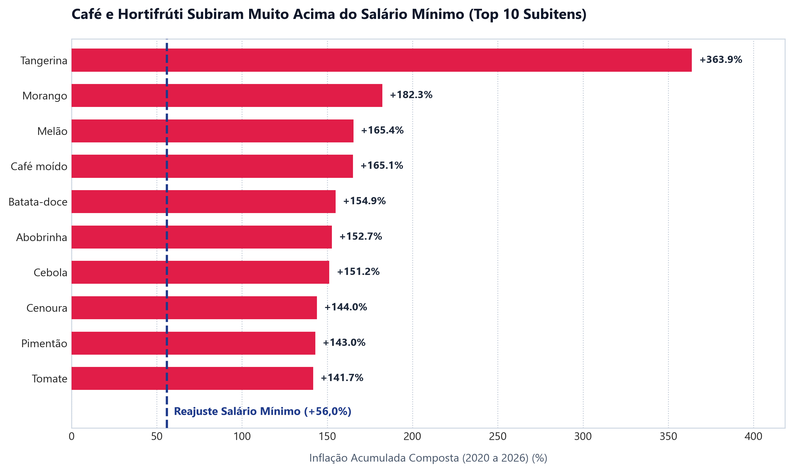
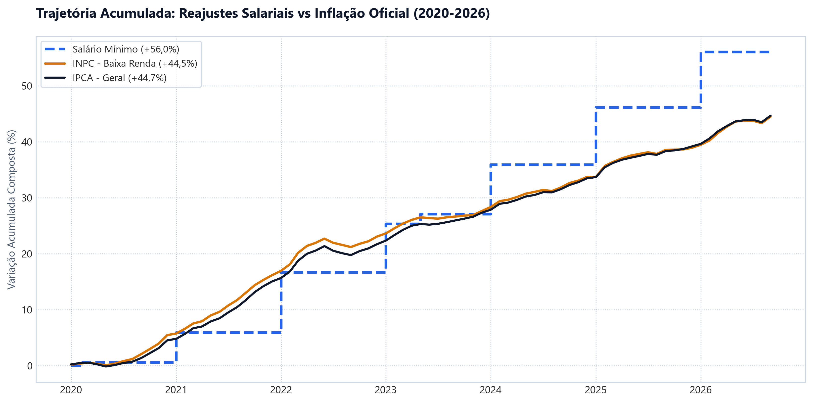
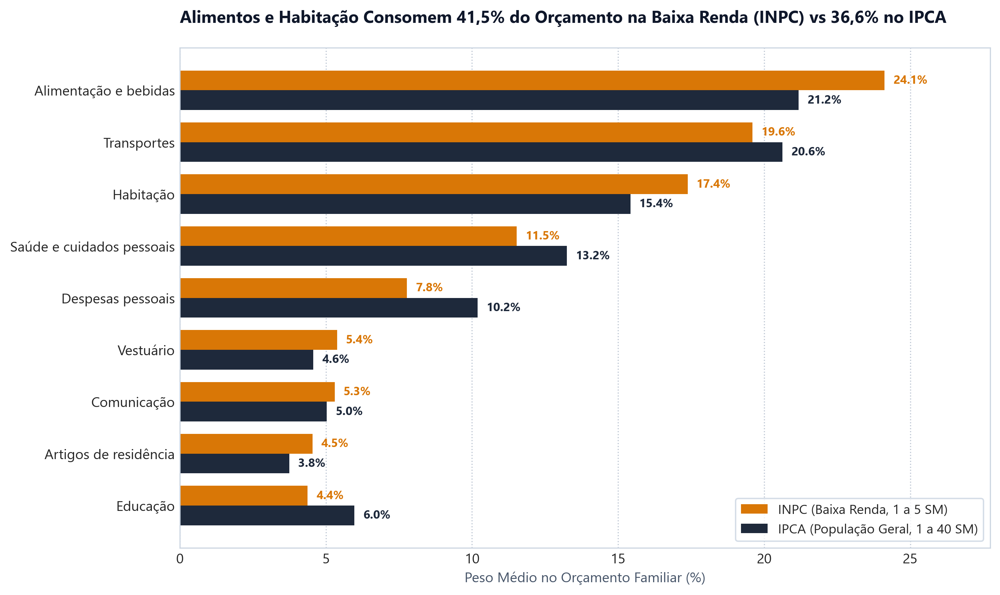

# Inflação e Poder de Compra no Brasil (2020–Hoje)

**Dashboard online:** https://projeto-inflacao-dajj9dnh8qffyvsccnk32c.streamlit.app/

Análise da perda de poder de compra e da compressão do orçamento das famílias de menor renda entre janeiro de 2020 e o período atual, confrontando dados oficiais do IPCA, INPC e Salário Mínimo.

---

## Objetivo do Projeto

Responder à seguinte pergunta: **quais gastos mais comprimiram o orçamento de quem ganha pouco no Brasil desde 2020?**

O estudo foca em três aspectos centrais:
1. **Comportamento por categoria:** Quais grupos e subitens específicos da cesta de consumo (alimentos, moradia, combustíveis) tiveram as maiores altas acumuladas.
2. **Poder de compra real:** Quais despesas subiram acima do reajuste acumulado do salário mínimo no mesmo intervalo.
3. **Diferença de impacto por faixa de renda:** Como a inflação geral (IPCA, 1 a 40 salários mínimos) se compara com a inflação da baixa renda (INPC, 1 a 5 salários mínimos), considerando a diferença de peso de cada despesa no orçamento.

---

## Principais Resultados

Com base nos dados oficiais do IBGE e do Banco Central (janeiro de 2020 a 2026):

- **O salário mínimo ganhou da inflação geral, mas perdeu para a comida:** O salário mínimo teve reajuste nominal acumulado de **+56,0%** (de R$ 1.039 para R$ 1.621), contra **+44,7%** do IPCA geral, o que representa um ganho real de cerca de **+7,9%**. Já o grupo **Alimentação e Bebidas** acumulou **+60,7%**, ou seja, na comida o salário mínimo perdeu cerca de **2,9%** de poder de compra.
- **123 dos 377 subitens superaram o reajuste do salário mínimo:** Vários alimentos de consumo diário tiveram altas de duas a seis vezes superiores ao reajuste (itens sazonais, como tomate e tangerina, são mais voláteis):
  - Café moído: **+165,1%**
  - Cebola: **+151,2%**
  - Cenoura: **+144,0%**
  - Tomate: **+141,7%**
  - Batata-inglesa: **+124,6%**
  - Tangerina: **+363,9%**
- **Peso maior da comida e da moradia na baixa renda:** No INPC, alimentação (24,1%) e habitação (17,4%) respondem por **41,5%** dos gastos da família, contra 36,6% no IPCA (médias mensais dos pesos no período). Porém, a inflação acumulada total foi praticamente a mesma: **+44,5% no INPC contra +44,7% no IPCA**. A diferença para a baixa renda está na composição do orçamento (menos margem para cortar gastos essenciais), e não em uma inflação total maior.

---

## Gráficos e Visualizações

### 1. Subitens com maior alta acumulada vs Salário Mínimo


### 2. Trajetória Acumulada: IPCA vs INPC vs Salário Mínimo


### 3. Comparação de Pesos no Orçamento: IPCA vs INPC


---

## Fontes de Dados

| Indicador | Fonte | Tabela / Série | Variáveis |
| :--- | :--- | :--- | :--- |
| **IPCA** | IBGE / SIDRA | Tabela 7060 | 63 (mensal), 66 (peso), 2265 (acumulada 12m) |
| **INPC** | IBGE / SIDRA | Tabela 7063 | 44 (mensal), 45 (peso), 2292 (acumulada 12m) |
| **Salário Mínimo** | Banco Central do Brasil | Série SGS 1619 | Valor nominal mensal (R$) |

---

## Metodologia

### 1. Cálculo da Inflação Acumulada Composta
Taxas percentuais mensais de inflação não podem ser somadas de forma linear. A taxa acumulada oficial segue o produto geométrico dos fatores de variação:

$$\Pi_{\text{acumulada}} = \left( \prod_{t=1}^{N} \left(1 + \frac{v_t}{100}\right) - 1 \right) \times 100$$

No SQLite, como não há operador nativo de produtório (`PROD`), utilizamos a identidade logarítmica:

$$\prod x = e^{\sum \ln(x)} \implies \text{EXP}\left(\sum \text{LN}\left(1 + \frac{v_t}{100}\right)\right)$$

Essa fórmula foi implementada diretamente nas consultas SQL da pasta `sql/`.

### 2. Alinhamento Temporal do Salário Mínimo
O salário mínimo é reajustado uma vez ao ano, enquanto o IPCA é divulgado mensalmente. Para comparar as duas grandezas:
- Fixou-se **janeiro de 2020** como mês base ($SM_0 = \text{R\$} 1.039,00$).
- Para qualquer mês $t$, o reajuste nominal acumulado do salário mínimo é:
  $$\Delta SM_t = \left(\frac{SM_t}{SM_0} - 1\right) \times 100$$
- Comparamos então a inflação composta de cada produto ou serviço no mesmo intervalo contra esse percentual.
- **Sensibilidade à base:** o salário mínimo subiu para R$ 1.045 em fevereiro de 2020. Usando essa base, o reajuste acumulado seria de +55,1% (em vez de +56,0%). A conclusão não muda.
- **Períodos distintos:** o IPCA/INPC vai até setembro de 2026, enquanto o salário mínimo considera o valor de 2026 (R$ 1.621), já definido para o ano todo.

---

## Estrutura do Projeto

```text
projeto-inflacao/
├── README.md                      # Documentação do projeto
├── requirements.txt               # Dependências do Python
├── validacao.md                   # Relatório de validação dos dados
├── data/
│   ├── raw/                       # Dados brutos (não versionados; gerados por src/coleta.py)
│   ├── processed/                 # Dados tratados (CSV/Parquet)
│   └── inflacao_brasil.db         # Banco relacional SQLite
├── src/
│   ├── coleta.py                  # Extração das APIs do IBGE e BCB
│   ├── tratamento.py              # Limpeza, parsing hierárquico e tipagem
│   ├── banco.py                   # Esquema DDL e carga no SQLite
│   └── gerar_graficos_docs.py     # Geração das imagens estáticas
├── sql/
│   ├── 01_inflacao_acumulada_periodo.sql
│   ├── 02_ranking_subitens_mais_subiram.sql
│   ├── 03_subitens_acima_salario_minimo.sql
│   ├── 04_variacao_12m_lag.sql
│   └── 05_diferenca_ipca_inpc.sql
├── notebooks/
│   ├── exploracao.py
│   └── exploracao.ipynb
├── dashboard/
│   └── app.py                     # Dashboard interativo em Streamlit
└── docs/                          # Gráficos em PNG gerados para documentação
```

---

## Como Reproduzir o Projeto

### 1. Clonar o repositório e preparar o ambiente
```bash
git clone https://github.com/DutraGuindani/projeto-inflacao.git
cd projeto-inflacao

python -m venv .venv

# Windows:
.\.venv\Scripts\activate

# Linux/macOS:
source .venv/bin/activate

pip install -r requirements.txt
```

### 2. Executar o pipeline de dados
```bash
# Baixa os dados das APIs públicas
python src/coleta.py

# Trata e classifica a hierarquia dos itens
python src/tratamento.py

# Cria as tabelas e carrega os dados no SQLite
python src/banco.py

# Gera os gráficos da pasta docs/
python src/gerar_graficos_docs.py
```

### 3. Rodar o dashboard interativo
```bash
streamlit run dashboard/app.py
```
O navegador abrirá automaticamente em `http://localhost:8501`.

---

## Consultas SQL

As consultas analíticas estão salvas e comentadas na pasta `sql/`. Abaixo, um exemplo da consulta que calcula o acumulado composto por grupo:

```sql
SELECT 
    nivel,
    nome_categoria,
    ROUND(AVG(peso_mensal), 2) AS peso_medio_cesta,
    ROUND((EXP(SUM(LN(1.0 + (variacao_mensal / 100.0)))) - 1.0) * 100.0, 2) AS inflacao_acumulada_pct
FROM ipca
WHERE variacao_mensal IS NOT NULL
  AND (1.0 + (variacao_mensal / 100.0)) > 0
GROUP BY nivel, codigo_hierarquico, nome_categoria
ORDER BY inflacao_acumulada_pct DESC;
```

---

## Limitações do Estudo

- **Cesta média vs indivíduo:** O IPCA e o INPC refletem o consumo médio das famílias apurado pela Pesquisa de Orçamentos Familiares (POF). Cada família tem um padrão de consumo particular, portanto a inflação percebida varia individualmente.
- **Diferenças regionais:** Os dados analisados são nacionais (Brasil consolidado). A inflação varia sensivelmente entre as regiões metropolitanas.
- **Ponderação dos pesos:** Os pesos dos itens são baseados na estrutura de consumo da POF 2017–2018. Mudanças recentes no padrão de gastos das famílias não são capturadas de imediato na ponderação do índice.
- **Periodicidade do salário:** O salário mínimo é reajustado uma vez ao ano, enquanto os preços sobem todo mês. Nos meses imediatamente anteriores ao reajuste anual, a perda momentânea de poder de compra tende a ser maior.
- **Itens voláteis:** produtos sazonais (tomate, tangerina, cebola) têm oscilações mensais fortes. Seus acumulados refletem em parte o ponto de partida e de chegada do período, e não uma tendência estável.
- **Pesos médios:** os pesos exibidos são a média dos pesos mensais divulgados pelo IBGE no período, e não os pesos originais da POF.
- **Validação:** o IPCA anual recalculado a partir do banco (2020 a 2025) coincide com os valores oficiais divulgados pelo IBGE.
